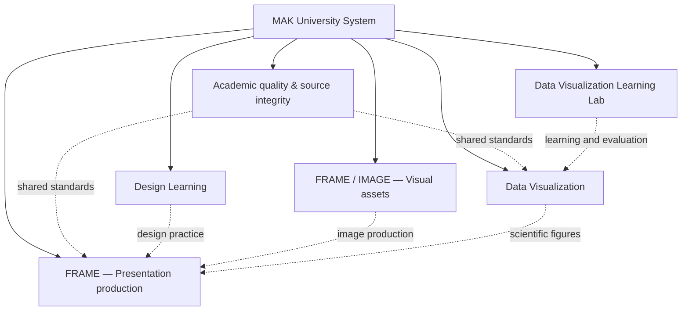

# MAK University System

**A personal academic knowledge and production system.**

MAK University System brings together reusable academic workflows, scientific communication practices, design guidance, and AI-assisted learning skills. Its purpose is to make university work more rigorous, coherent, and reproducible while keeping the process lightweight.

> Accuracy before aesthetics. Structure before decoration. Evidence before claims.

This is a version-controlled knowledge repository, not a software application, course archive, or collection of finished assignments.

## Start here

| I want to… | Open |
| --- | --- |
| Understand how the system works | [Agent guidance](AGENTS.md) |
| Check academic and scientific quality | [Academic quality](standards/academic-quality.md) · [Source integrity](standards/source-integrity.md) |
| Plan, design, or review a presentation | [FRAME production workflow](skills/frame-presentations/SKILL.md) · [Design guidebook](design/frame-guidebook.md) |
| Study visual design | [Design Learning](skills/design-learning/SKILL.md) |
| Find, create, refine, and embed presentation images | [FRAME / IMAGE](skills/visual-assets/SKILL.md) |
| Create research figures and charts | [Data Visualization](skills/data-visualization/SKILL.md) |
| Learn scientific visualization and AI evaluation | [Data Visualization Learning Lab](skills/data-visualization-learning/SKILL.md) |

## System architecture



Shared academic standards apply across the repository. Learning skills support experimentation and understanding; production skills guide actual deliverables. Neither overrides the requirements of a course, research task, or current user instruction.

## FRAME — Presentation Architecture | Design & Production

FRAME is the implemented presentation workflow for technical, university, research, and professional communication. It combines narrative structure, accurate diagrams, restrained visual identity, editable deliverables, and practical rendering checks.

Its design foundation uses Swiss-inspired grid composition, Inter for Latin-script typography, Lucide-first iconography, and the working MAK color tokens Paper `#F5F3EE`, Ink `#161616`, and Signal `#E64B3C`. Persian companion typography and some brand details remain open for testing.

Read the [production skill](skills/frame-presentations/SKILL.md), [guidebook](design/frame-guidebook.md), and [iconography standard](design/iconography.md). The [Lucide starter assets](assets/icons/lucide/) retain their upstream licensing notice.

## Learning and scientific communication

### Visual design

The [Design Learning facilitator](skills/design-learning/SKILL.md) connects five practical modules: [grid systems](skills/design-grid-systems/SKILL.md), [typography](skills/design-typography/SKILL.md), [visual hierarchy](skills/design-visual-hierarchy/SKILL.md), [slide rhythm](skills/design-slide-rhythm/SKILL.md), and [motion](skills/design-motion/SKILL.md). Its [source catalog](skills/design-learning/SOURCES.md) preserves seven original design references and their scope limitations.

### FRAME / IMAGE — Visual assets

The [visual-assets skill](skills/visual-assets/SKILL.md) connects visual research, art direction, AI generation and refinement, technical illustration, licensing, and image embedding. Its [twelve guided lessons](skills/visual-assets/LEARNING-PATH.md) and [two pilot records](skills/visual-assets/PRODUCTION-QA.md) establish a working production workflow while documenting unresolved compatibility and documentary-photography tests. Assets remain separate from the public repository until their rights are reviewed.

### Data visualization

The [production skill](skills/data-visualization/SKILL.md) supports accurate, accessible, reproducible charts. The [tool catalog](skills/data-visualization/SOURCES.md) covers Matplotlib, Vega-Altair, Plotly, Apache ECharts, and Observable Plot. Tools are chosen by purpose rather than treated as mandatory dependencies.

The [reproducible learning-curves example](skills/data-visualization/examples/README.md) provides a small synthetic CSV and Python comparison script. Static figures, interactive HTML, and native PowerPoint charts are distinct deliverables.

### Data Visualization Learning Lab

The [learning skill](skills/data-visualization-learning/SKILL.md) documents twelve completed teaching studies:

| Phase | Studies | Focus |
| --- | --- | --- |
| Visualization and statistics | 01–05 | Libraries, chart selection, distributions, uncertainty, paired comparisons, reliable benchmarking |
| Model evaluation and explanations | 06–09 | Subgroups, metrics, calibration, feature importance, SHAP, explanation stability |
| Counterfactuals and monitoring | 10–12 | Feasible actions, robustness, uncertainty validation, monitoring |

Explore the [learning path](skills/data-visualization-learning/LEARNING-PATH.md) and [evidence register](skills/data-visualization-learning/EVIDENCE.md). The original lesson archives remain outside this public repository. All constructed exercise results are synthetic; they do not establish real model performance or causal effects.

## Working with AI assistants

Provide the repository link or relevant files to an assistant that can access them, then identify the task and its actual source materials.

1. Read [AGENTS.md](AGENTS.md) and the shared academic standards.
2. Load only the skill relevant to the task and reopen its sources when needed.
3. Follow the actual assignment or research requirements.
4. Check technical correctness, evidence, accessibility, and the exported deliverable.
5. Document meaningful improvements through small, reviewable changes.

A Markdown skill is reusable workflow guidance. It does not automatically install a ChatGPT capability, load itself into every conversation, or install software dependencies.

## Repository layout

```text
MAK-University-System/
├── AGENTS.md          # Agent navigation and working conventions
├── standards/         # Academic quality and source integrity
├── skills/            # Production workflows and learning modules
│   └── data-visualization/examples/
├── design/            # FRAME guidebook and iconography
└── assets/icons/      # Curated, licensed SVG starter assets
```

## Status and boundaries

The foundation is in use: FRAME production, five design-learning modules, scientific visualization, twelve documented DataViz studies, and the FRAME / IMAGE visual-assets workflow (twelve guided lessons and two production pilots). The system evolves through actual academic work rather than speculative infrastructure.

Open items include Persian typography, classroom font and animation compatibility, and untested optional visualization export paths, native Office image compatibility, and authentic external photo embedding. Future workflows are added when real tasks justify them.

This public repository intentionally excludes private course records, unpublished research, credentials, confidential material, original personal logo files pending publication approval, and large teaching archives. Third-party assets retain their applicable license notices. No repository-wide open-source license is asserted here.

---

**MAK University System** · A living academic knowledge and production system.
